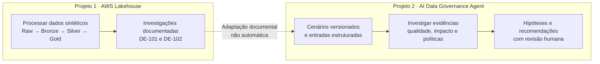
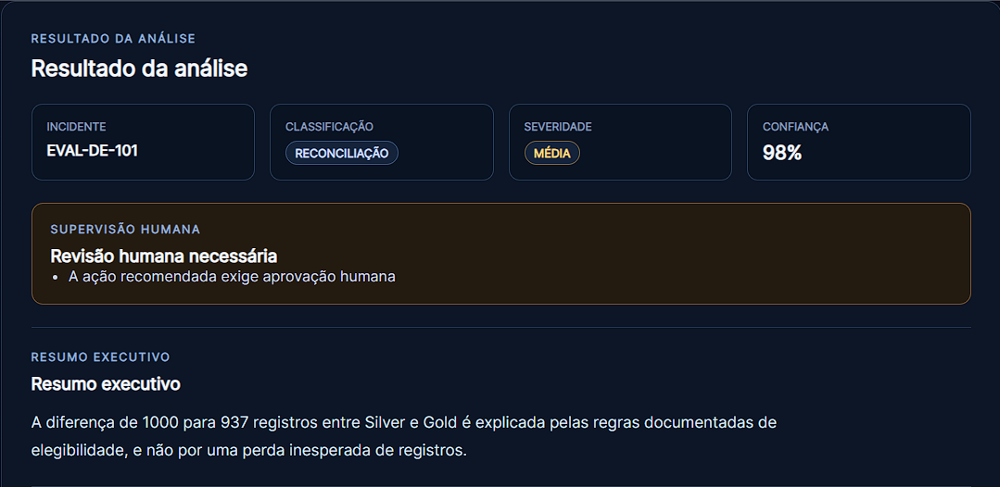
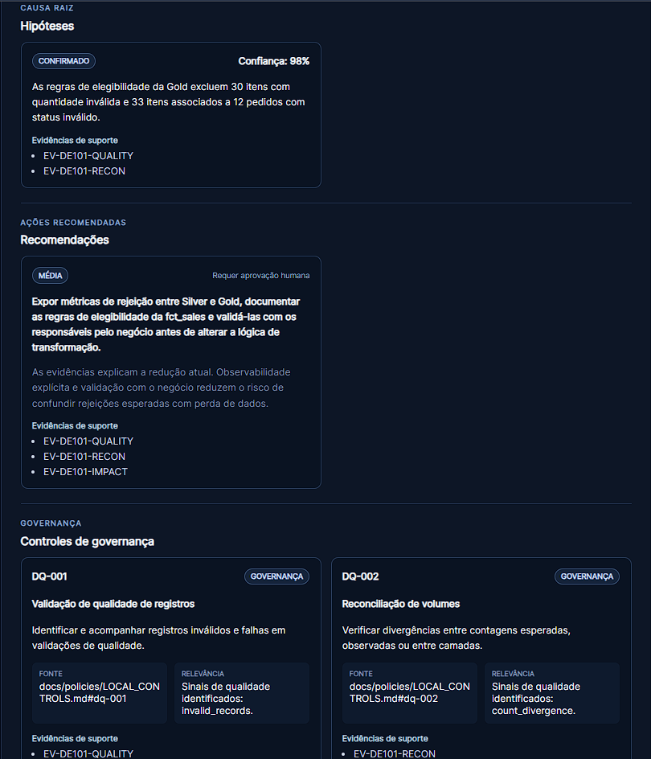
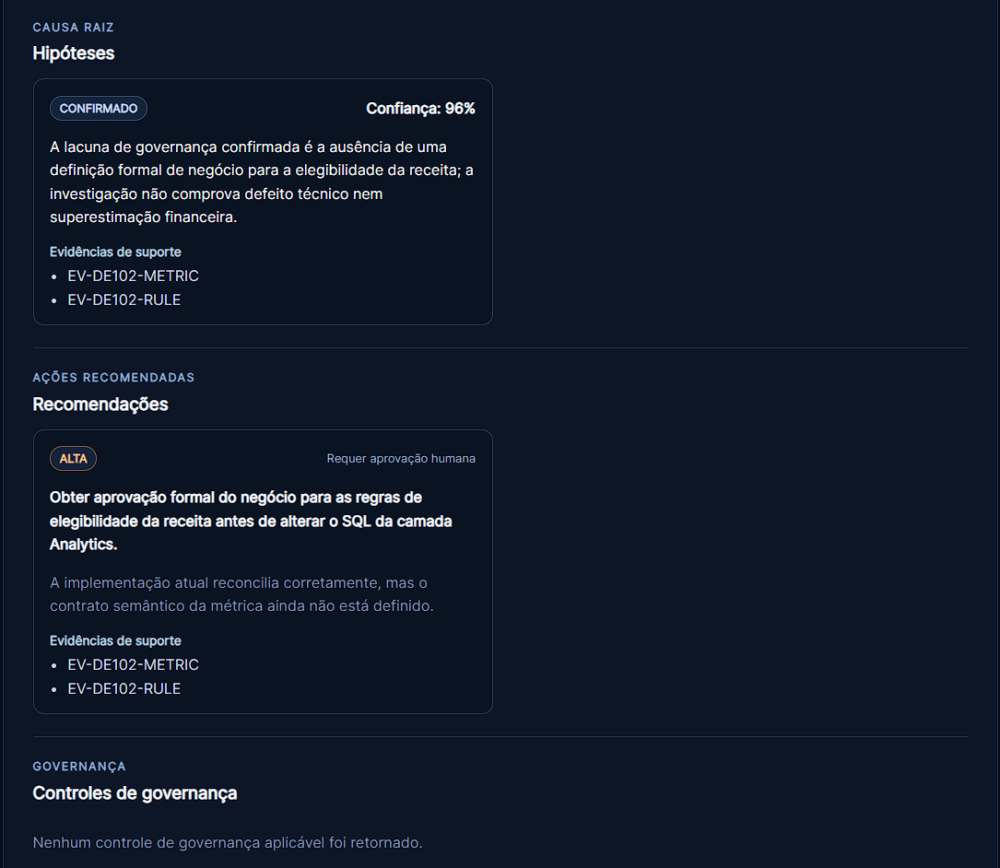

# AI Data Governance Agent

**Da Engenharia de Dados à governança: transformando evidências de incidentes em análises compreensíveis, rastreáveis e sujeitas à revisão humana.**

> **Em poucas palavras:** quando um relatório mostra números diferentes ou uma métrica de negócio parece ambígua, não basta apontar o problema. É preciso entender os fatos, separar hipóteses de conclusões e decidir quem deve aprovar uma mudança. É isso que este projeto demonstra.

Este é um **projeto de portfólio e laboratório com cenários controlados**, desenvolvido na **Imersão de Agentes de IA para Negócios — Alura + Oracle Next Education (ONE)**. As demonstrações usam um **provider determinístico**, sem depender de um LLM externo em produção.

**Leitura rápida:** [O projeto em um minuto](#em-um-minuto) · [Conexão com o AWS Lakehouse](#conexao-aws) · [O que está integrado](#integracao-real) · [Cenários com imagens](#cenarios) · [Execução e avaliação](#execucao)

---

## O projeto em um minuto

| Pergunta | Explicação sem jargão |
| --- | --- |
| **Que problema resolve?** | Ajuda a investigar por que números diferem entre etapas de processamento ou por que uma métrica pode ser interpretada de formas diferentes. |
| **O que foi construído?** | Uma aplicação web e API que recebem evidências estruturadas, executam verificações e organizam uma análise de incidentes. |
| **O que entrega?** | Classificação, severidade, hipóteses fundamentadas, possíveis impactos, recomendações e indicação de necessidade de revisão humana. |
| **O que o torna verificável?** | Cada cenário possui fatos documentados, casos reproduzíveis, contratos de entrada e saída, testes e guardrails para conclusões sem suporte. |
| **Qual é o limite?** | É uma ferramenta **consultiva**: não modifica automaticamente dados, não aprova mudanças no lugar de pessoas e não executa um LLM real no modo padrão. |

## Como se conecta ao AWS Lakehouse Engineering Lab?

Os dois repositórios demonstram **etapas complementares de um mesmo problema de negócio**:

1. **[AWS Lakehouse Engineering Lab](https://github.com/brodyandre/aws-lakehouse-engineering-lab)** — cria e processa dados sintéticos de e-commerce, aplica regras de qualidade e publica tabelas analíticas usando PySpark, Airflow e SQL.
2. **Investigações documentadas** — o laboratório registra o que foi observado quando surgem diferenças entre as camadas ou dúvidas sobre o significado de uma métrica.
3. **AI Data Governance Agent (este repositório)** — reutiliza os fatos dessas investigações como **cenários estruturados e versionados** para demonstrar análise de evidências, governança e recomendações sob supervisão humana.

**A distinção essencial:** existe **conexão por conhecimento e evidências rastreáveis**, não uma integração de execução em tempo real. O agente **não acessa automaticamente** o banco, o Trino, o MinIO ou os pipelines do Lakehouse; os dois projetos podem ser executados de forma independente.

### Dois exemplos que conectam os projetos

| Investigação no AWS Lakehouse | O que o agente demonstra | Confira as duas pontas |
| --- | --- | --- |
| **DE-101 — Diferença de registros:** a Silver contém 1.000 itens, mas a Gold publica 937 após regras de elegibilidade. | Identifica que a diferença de 63 registros pode ser explicada pelas regras de qualidade, sem afirmar perda inesperada ou defeito sem provas. | [Relatório original](https://github.com/brodyandre/aws-lakehouse-engineering-lab/blob/main/docs/incidents/de-101-raw-silver-divergence.md) · [Cenário do agente](docs/scenarios/DE-101.md) |
| **DE-102 — Significado da receita:** os totais Gold e Analytics coincidem, mas falta formalizar quais status de pedido entram na métrica. | Distingue conciliação técnica de regra de negócio e recomenda definir a métrica com os responsáveis antes de alterar o SQL. | [Relatório original](https://github.com/brodyandre/aws-lakehouse-engineering-lab/blob/main/docs/incidents/de-102-analytics-revenue-status.md) · [Cenário do agente](docs/scenarios/DE-102.md) |

As investigações aconteceram em um **laboratório com dados sintéticos**. As análises mostradas aqui são demonstrações controladas; não representam incidentes corporativos em produção.

## O que está integrado de verdade?

A conexão **dentro desta aplicação** é funcional: a interface **Node.js/Express** encaminha o incidente à **API FastAPI**, que executa o **workflow LangGraph** quando um provider está configurado.

| Integração ou capacidade | Situação atual |
| --- | --- |
| **Interface web → API FastAPI** | **Implementada**, por requisição HTTP. |
| **API → workflow, ferramentas e guardrails** | **Implementada**, mediante configuração de um provider. |
| **Casos do AWS Lakehouse → cenários do agente** | **Implementada como adaptação documental e dados de demonstração versionados**; não é ingestão automática. |
| **Lakehouse → agente via API/eventos em tempo real** | **Não implementada**. |
| **LLM externo e aprovação/remediação em produção** | **Não implementados no modo demonstrado**. A solução sinaliza quando uma decisão exige revisão humana, mas não executa remediações críticas. |

Para reproduzir a demonstração DE-101/DE-102, é necessário preparar o provider determinístico conforme o [runbook](docs/demo/LIVE_DEMO_RUNBOOK.md). Sem provider, a API padrão devolve o erro controlado `503 provider_not_configured`. A classificação e as recomendações apresentadas nesse modo são resultados de um cenário controlado, **não provas de inferência de um LLM externo**.

**Quer aprofundar a conexão?** O documento [**Da investigação no Lakehouse à resposta do agente**](docs/CONEXAO_AWS_LAKEHOUSE.md) mapeia as fontes, os artefatos e os limites de cada parte.

---

## Sumário

- [O projeto em um minuto](#em-um-minuto)
- [Como se conecta ao AWS Lakehouse](#conexao-aws)
- [O que está integrado de verdade](#integracao-real)
- [Visão Geral](#visao-geral)
- [Problema de Negócio](#problema-negocio)
- [Solução Proposta](#solucao-proposta)
- [Capacidades Implementadas](#capacidades)
- [Arquitetura](#arquitetura)
- [Ferramentas do Agente](#ferramentas)
- [Human-in-the-loop e Guardrails](#human-in-the-loop)
- [Rastreabilidade de Evidências](#rastreabilidade)
- [Cenários de Demonstração](#cenarios)
- [Stack Tecnológica](#stack)
- [Como Executar Localmente](#execucao)
- [Qualidade e Testes](#qualidade)
- [Avaliação](#avaliacao)
- [Limitações](#limitacoes)
- [Documentação](#documentacao)
- [Projetos Relacionados](#projetos-relacionados)
- [Próximos Passos](#proximos-passos)
- [Autor](#autor)

---

## Visão Geral

O **AI Data Governance Agent** auxilia profissionais de dados na investigação de incidentes a partir de evidências técnicas, regras de negócio e controles de governança.

A solução combina componentes determinísticos com uma camada de abstração para providers, mantendo decisões críticas sob supervisão humana.

O agente foi projetado para responder perguntas como:

- quais evidências sustentam a análise;
- qual é a severidade do incidente;
- quais consumidores ou processos podem ser afetados;
- quais hipóteses de causa raiz são compatíveis com as evidências;
- quais controles de governança são aplicáveis;
- quais próximos passos são recomendados;
- quando a decisão precisa ser revisada por uma pessoa.

O foco é produzir análises **estruturadas, explicáveis, auditáveis e reproduzíveis**.

[Voltar ao índice](#sumario)

---

## Problema de Negócio

Incidentes de dados normalmente são investigados a partir de informações distribuídas entre relatórios de pipelines, resultados de validações, divergências de reconciliação, logs, regras de negócio, políticas de governança e observações de analistas.

Essa fragmentação pode aumentar o tempo de investigação e gerar interpretações inconsistentes sobre severidade, causa raiz, impacto de negócio e prioridade de remediação.

O projeto transforma essas evidências fragmentadas em uma análise única, estruturada e rastreável.

[Voltar ao índice](#sumario)

---

## Solução Proposta

O fluxo implementado:

1. recebe um incidente estruturado;
2. valida o contrato de entrada;
3. coleta e organiza as evidências disponíveis;
4. analisa sinais de Data Quality;
5. avalia possíveis impactos de negócio;
6. consulta controles e políticas de governança;
7. produz hipóteses de causa raiz;
8. recomenda próximos passos;
9. calcula o nível de confiança;
10. determina se revisão humana é necessária;
11. retorna uma resposta estruturada e rastreável.

A solução possui caráter **consultivo** e não executa automaticamente ações críticas de remediação.

[Voltar ao índice](#sumario)

---

## Capacidades Implementadas

| Capacidade | Estado |
| --- | --- |
| Contratos estruturados de incidente e resposta | Implementado |
| Workflow de investigação com LangGraph | Implementado |
| API HTTP com FastAPI | Implementada |
| Interface web com Node.js e Express | Implementada |
| Análise de Data Quality | Implementada |
| Avaliação de impacto de negócio | Implementada |
| Recuperação de controles de governança | Implementada |
| Organização e rastreabilidade de evidências | Implementada |
| Hipóteses e recomendações estruturadas | Implementadas |
| Human-in-the-loop | Implementado |
| Guardrails para evidência insuficiente e claims sem suporte | Implementados |
| Framework de avaliação determinística | Implementado |
| CI com GitHub Actions | Implementado |
| Cenários de demonstração reproduzíveis | Implementados |

[Voltar ao índice](#sumario)

---

## Arquitetura

Fluxo principal da solução:

~~~text
Interface Web
     |
     v
Express /api/analyze
     |
     v
FastAPI
     |
     v
Validação do incidente
     |
     v
Workflow LangGraph
     |
     +-------------------------------+
     |                               |
     v                               v
Evidence Collector            Quality Analyzer
     |                               |
     +---------------+---------------+
                     |
                     v
          Business Impact Analyzer
                     |
                     v
             Policy Retriever
                     |
                     v
       Hipóteses e Recomendações
                     |
                     v
          Guardrails e Confiança
                     |
                     v
             Human Review
                     |
                     v
              AgentResponse
~~~

A arquitetura mantém separadas as responsabilidades de contratos, ferramentas determinísticas, orquestração, provider, guardrails, API e interface.

Essa separação permite testar o comportamento do sistema sem depender obrigatoriamente de um modelo externo.

[Voltar ao índice](#sumario)

---

## Ferramentas do Agente

| Ferramenta | Responsabilidade |
| --- | --- |
| evidence_collector | Organizar evidências e preservar sua origem |
| quality_analyzer | Avaliar sinais relacionados à qualidade dos dados |
| business_impact_analyzer | Relacionar problemas técnicos a possíveis impactos de negócio |
| policy_retriever | Recuperar políticas e controles de governança aplicáveis |

As ferramentas são independentes da geração textual e possuem testes próprios. Isso reduz o risco de delegar ao modelo tarefas que podem ser executadas de forma determinística e verificável.

[Voltar ao índice](#sumario)

---

## Human-in-the-loop e Guardrails

O agente não substitui a decisão humana em situações críticas.

A revisão humana pode ser exigida por condições como severidade crítica, impacto material de negócio, baixa confiança, evidências insuficientes ou conflitantes, risco regulatório, risco de privacidade, violação de governança e recomendações que exigem autorização.

Os guardrails evitam apresentar conclusões como fatos quando não existem evidências suficientes para sustentá-las.

O comportamento esperado é conservador: quando a informação não é suficiente, a solução explicita a limitação em vez de inventar evidências ou controles.

[Voltar ao índice](#sumario)

---

## Rastreabilidade de Evidências

Um dos princípios centrais do projeto é manter separadas as diferentes camadas de interpretação:

~~~text
Evidência observada
        |
        v
Resultado determinístico
        |
        v
Hipótese
        |
        v
Recomendação
~~~

Cada conclusão relevante pode ser relacionada às evidências que a sustentam.

Isso permite responder de onde a evidência foi obtida, se a informação foi observada, calculada ou inferida, qual é o nível de confiança e por que uma revisão humana foi solicitada.

A rastreabilidade é tratada como requisito funcional, não apenas como documentação.

[Voltar ao índice](#sumario)

---

## Cenários de Demonstração

### DE-101 — Elegibilidade Silver → Gold

**Origem verificável:** [investigação DE-101 no AWS Lakehouse](https://github.com/brodyandre/aws-lakehouse-engineering-lab/blob/main/docs/incidents/de-101-raw-silver-divergence.md). Os números foram adaptados como cenário estruturado; não são dados consultados ao vivo pelo agente.

O cenário investiga uma diferença entre a quantidade de itens disponível na camada Silver e os registros publicados em fct_sales.

~~~text
Silver order_items
1000 registros
      |
      | - 30 itens com quantity inválida
      v
970 registros elegíveis
      |
      | - 33 itens associados a 12 pedidos inválidos
      v
Gold fct_sales
937 registros
~~~

A redução é explicada pelas regras documentadas de elegibilidade.

O cenário demonstra Data Quality, reconciliação, rastreabilidade, hipótese baseada em evidências, controles de governança, recomendação consultiva e revisão humana.

Documentação: [docs/scenarios/DE-101.md](docs/scenarios/DE-101.md)

  

<em>DE-101 — visão geral da análise com classificação de reconciliação, confiança e supervisão humana.</em>

  

<em>DE-101 — hipótese confirmada, recomendação consultiva, evidências de suporte e controles DQ-001 e DQ-002.</em>

### DE-102 — Governança da Semântica de Receita

**Origem verificável:** [investigação DE-102 no AWS Lakehouse](https://github.com/brodyandre/aws-lakehouse-engineering-lab/blob/main/docs/incidents/de-102-analytics-revenue-status.md). A comparação alternativa de receitas é hipotética e não representa perda financeira comprovada.

O cenário investiga uma possível divergência na definição de receita.

As camadas Gold e Analytics reconciliam tecnicamente o mesmo valor. A investigação identifica que o risco não está em uma divergência técnica comprovada, mas na ausência de um contrato semântico formal para definir quais status devem compor a métrica de receita.

O cenário demonstra distinção entre reconciliação técnica e semântica de negócio, governança de métricas, prevenção de conclusões financeiras sem evidência e necessidade de aprovação humana antes da alteração da regra.

Documentação: [docs/scenarios/DE-102.md](docs/scenarios/DE-102.md)

  

<em>DE-102 — hipótese de governança, recomendação de alta prioridade, evidências rastreáveis e aprovação humana obrigatória.</em>

[Voltar ao índice](#sumario)

---

## Stack Tecnológica

| Categoria | Tecnologia | Papel |
| --- | --- | --- |
| Linguagem | Python 3.12 | Backend e regras de negócio |
| API | FastAPI | Exposição HTTP |
| Contratos | Pydantic | Validação e modelos estruturados |
| Orquestração | LangGraph | Workflow do agente |
| Frontend | Node.js | Runtime da interface |
| Web | Express | Servidor e integração com a API |
| Templates | EJS | Renderização da interface |
| Browser | Vanilla JavaScript | Interação e apresentação |
| Testes | pytest | Testes automatizados Python |
| Testes web | Node Test Runner | Testes da interface |
| Qualidade | Ruff | Lint e formatação |
| CI | GitHub Actions | Quality gates automáticos |

### Provider de modelo

A aplicação utiliza uma abstração de provider.

Testes, avaliação e demonstração podem operar de forma determinística, sem dependência obrigatória de um serviço externo de IA.

Essa abordagem mantém o projeto reproduzível e permite integrar outros providers futuramente sem alterar os contratos centrais da aplicação.

[Voltar ao índice](#sumario)

---

## Como Executar Localmente

### Pré-requisitos

- Python 3.12
- Node.js 20+
- npm
- Git
- Linux, WSL2 ou ambiente equivalente

### Clonar o repositório

~~~bash
git clone https://github.com/brodyandre/ai-data-governance-agent.git
cd ai-data-governance-agent
~~~

### Criar o ambiente virtual

~~~bash
python3.12 -m venv .venv
source .venv/bin/activate
~~~

### Instalar o projeto

~~~bash
python -m pip install -e ".[dev]"
~~~

### Validar dependências

~~~bash
python -m pip check
~~~

### Executar os testes Python

~~~bash
pytest
~~~

### Interface web

A instalação e a execução do frontend estão documentadas em [web/README.md](web/README.md).

### Demonstração end-to-end

O procedimento completo e reproduzível está disponível em [docs/demo/LIVE_DEMO_RUNBOOK.md](docs/demo/LIVE_DEMO_RUNBOOK.md).

A configuração padrão da API não injeta automaticamente um provider externo. Quando nenhum provider está configurado, o endpoint de análise retorna o erro controlado provider_not_configured.

[Voltar ao índice](#sumario)

---

## Qualidade e Testes

Os principais quality gates podem ser executados com:

~~~bash
python -m pip check
ruff check .
ruff format --check .
pytest
cd web && npm test
~~~

A avaliação determinística é executada com:

~~~bash
python -m ai_data_governance_agent.evaluation
~~~

O GitHub Actions executa automaticamente os principais quality gates do repositório.

A suíte cobre contratos de domínio, API, ferramentas, providers, guardrails, workflow, avaliação e interface web.

[Voltar ao índice](#sumario)

---

## Avaliação

O projeto possui um framework de avaliação determinística e reproduzível.

| Métrica | Objetivo |
| --- | --- |
| schema_valid_rate | Validar conformidade das respostas |
| severity_accuracy | Avaliar classificação de severidade |
| evidence_traceability_rate | Medir rastreabilidade das conclusões |
| unsupported_rejection_rate | Medir rejeição de conclusões sem suporte |
| human_review_accuracy | Avaliar decisões de revisão humana |
| tool_execution_success_rate | Medir execução das ferramentas |
| response_latency | Registrar latência |
| test_pass_rate | Acompanhar estabilidade do workflow |

A avaliação utiliza cenários versionados e um provider determinístico.

Os resultados medem o comportamento do workflow, das ferramentas e dos guardrails para esse conjunto controlado de cenários. Eles não devem ser interpretados como benchmark de qualidade de um LLM real em produção.

Metodologia completa: [docs/EVALUATION.md](docs/EVALUATION.md)

[Voltar ao índice](#sumario)

---

## Limitações

A implementação atual foi deliberadamente mantida com escopo controlado:

- o caminho padrão não depende de um LLM externo;
- o provider utilizado na demonstração é determinístico;
- o catálogo local de políticas possui escopo limitado aos controles versionados no projeto;
- o agente não executa remediações críticas automaticamente;
- a avaliação utiliza cenários controlados e não representa tráfego produtivo;
- persistência distribuída, observabilidade externa e infraestrutura cloud não são requisitos obrigatórios da solução atual.

Essas decisões priorizam reprodutibilidade, segurança, testabilidade e transparência.

[Voltar ao índice](#sumario)

---

## Documentação

O índice completo está em [docs/README.md](docs/README.md).

| Documento | Conteúdo |
| --- | --- |
| [PROJECT_CHARTER.md](docs/PROJECT_CHARTER.md) | Visão, objetivos e escopo |
| [EVALUATION.md](docs/EVALUATION.md) | Framework e métricas de avaliação |
| [LIVE_DEMO_RUNBOOK.md](docs/demo/LIVE_DEMO_RUNBOOK.md) | Execução reproduzível da demonstração |
| [DEMO_NARRATIVE.md](docs/demo/DEMO_NARRATIVE.md) | Narrativa técnica da demonstração |
| [DE-101.md](docs/scenarios/DE-101.md) | Cenário de elegibilidade Silver → Gold |
| [DE-102.md](docs/scenarios/DE-102.md) | Cenário de governança da métrica de receita |
| [AGENT_RESPONSE.md](docs/contracts/AGENT_RESPONSE.md) | Contrato conceitual da resposta |
| [SEVERITY_AND_HUMAN_REVIEW.md](docs/contracts/SEVERITY_AND_HUMAN_REVIEW.md) | Regras de severidade e revisão humana |
| [ROADMAP.md](docs/ROADMAP.md) | Evolução técnica do projeto |
| [BACKLOG.md](docs/BACKLOG.md) | Histórico detalhado das entregas |

A documentação utiliza português brasileiro como idioma principal. Identificadores técnicos, classes, campos, métricas e nomes de componentes permanecem em inglês quando fazem parte dos contratos de software.

[Voltar ao índice](#sumario)

---

## Projetos Relacionados

**A relação com o AWS Lakehouse é baseada em investigações de dados sintéticos transformadas em cenários de análise versionados.** O [mapeamento detalhado](docs/CONEXAO_AWS_LAKEHOUSE.md) mostra o vínculo entre os relatórios de origem e a análise do agente, sem sugerir integração automática em runtime.

Outros projetos do portfólio complementam os conceitos demonstrados neste repositório:

- [AWS Lakehouse Engineering Lab](https://github.com/brodyandre/aws-lakehouse-engineering-lab) — Lakehouse, PySpark, Airflow, Data Quality, observabilidade e FinOps;
- [Databricks Lakehouse Data Engineering Lab](https://github.com/brodyandre/databricks-lakehouse-data-engineering-lab) — Databricks, Spark, Delta Lake e arquitetura Medallion.

Os projetos são independentes, mas compartilham princípios de Engenharia de Dados, qualidade, governança, automação e reprodutibilidade.

[Voltar ao índice](#sumario)

---

## Próximos Passos

Evoluções possíveis, sem alterar os contratos centrais:

- integração opcional com providers reais de modelos;
- expansão do catálogo de políticas e controles;
- persistência de incidentes e resultados;
- observabilidade operacional externa;
- autenticação e autorização;
- integração com catálogos corporativos;
- execução em ambiente cloud;
- ampliação do dataset de avaliação.

Essas extensões são tratadas como evolução da solução, e não como requisitos para demonstrar o comportamento atual.

[Voltar ao índice](#sumario)

---

## Autor

**Luiz André de Souza**

Data Engineering | Software Engineering | Cloud Computing | Data Quality | Data Governance | AI Agents

GitHub: [brodyandre](https://github.com/brodyandre)

LinkedIn: [Luiz André de Souza](https://www.linkedin.com/in/luiz-andre-souza-data-engineer/)

---

**AI Data Governance Agent** — transformando evidências fragmentadas de incidentes de dados em análises estruturadas, rastreáveis e orientadas à governança.

[Voltar ao índice](#sumario)
